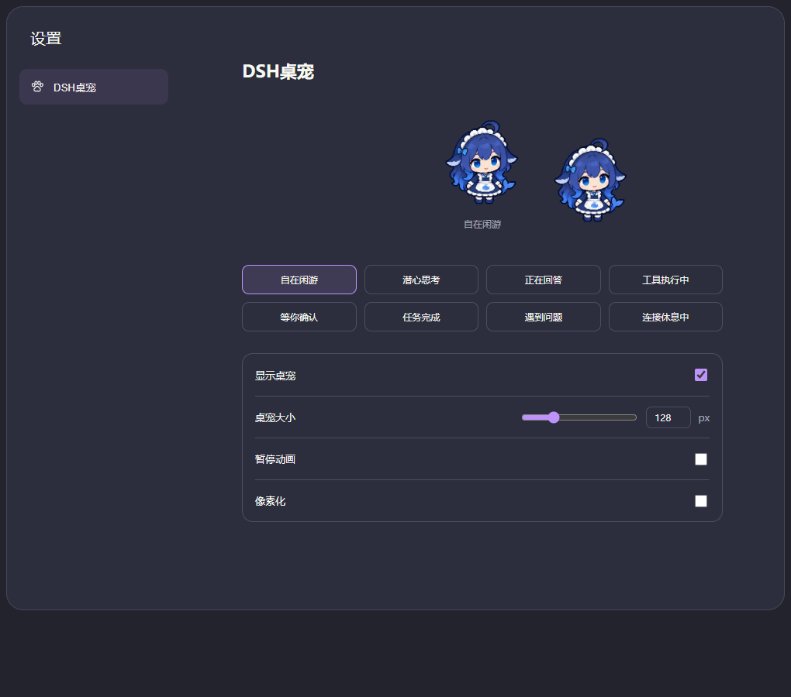

# DSH桌宠 · dsh-aquarium

为 DeepSeek Harness 添加一个透明背景的鲸鱼娘桌宠，跟随当前会话切换思考、回答、工具执行、等待确认和完成等动作。

**0.4.0 预览版 · 目标 DSH Desktop 0.2.0-rc.2 · MIT**

[下载安装包](https://github.com/Ether0516/dsh-aquarium/releases) · [维护形象和动作](SKINS.md) · [开发说明](CONTRIBUTING.md)



图中为模拟 DSH 容器的浏览器预览，包含设置页角色和应用内角色。

## 功能

- 透明角色，保留低帧率动画节奏，动作之间经过中间站姿。
- Windows 桌面版提供独立透明浮窗，可使用软件窗口之外的屏幕坐标，并保存位置；鼠标按住角色拖动。
- 其他平台和网页版使用应用内角色，可在当前界面内拖动。
- 所有选项位于「设置 → DSH桌宠」，使用爪印图标，八个动作预览按钮为两行四个。
- 支持显示/隐藏、64–320 px 大小调整、暂停动画和「像素化」开关。
- 像素化默认关闭，开启后采用低分辨率与最近邻放大。原始素材已有插画风格，关闭像素化保留更多原图细节。
- 样式、精灵图、动作帧序、速度和状态映射独立配置；多个样式自动出现选择框。

Windows 浮窗属于预览功能：已验证编译、透明素材绘制与状态通信，实际 DSH 重启加载、跨窗口鼠标拖动和真实模型任务中的完整动画仍需要实机验证。其余已执行的检查见 [DEVELOPMENT.md](DEVELOPMENT.md)。

## 安装

先启动一次 DSH Desktop，让它初始化桌面配置，再完全退出应用，包括托盘进程。

1. 在 [Releases](https://github.com/Ether0516/dsh-aquarium/releases) 下载 `dsh-aquarium-0.4.0.tgz`。
2. 在安装包所在目录打开终端，使用 **DSH 桌面版自带的** `dsh` 命令安装：

```powershell
dsh plugin --profile desktop add ".\dsh-aquarium-0.4.0.tgz" --offline
```

3. 重新打开 DSH，在「设置 → DSH桌宠」调整选项。

包内提供 Windows 浮窗 EXE，普通用户不需要 Node.js、Python 或 C# 编译器，也不需要编译源码。DSH 运行时需满足上方版本兼容要求；其他 DSH 版本尚未验证。

升级时完全退出 DSH，安装新版本的 `.tgz`，再重新打开。插件包名沿用 `dsh-aquarium`。

也可以从源码目录安装。先按 [CONTRIBUTING.md](CONTRIBUTING.md) 构建，再执行：

```powershell
dsh plugin --profile desktop add "." --offline
```

停用可在 DSH 插件页操作。卸载命令：

```powershell
dsh plugin --profile desktop remove dsh-aquarium
```

## 动作

| 当前状态 | 表现 |
| --- | --- |
| 空闲 | 站姿、呼吸与眨眼 |
| 思考 | 托腮与歪头 |
| 回答 | 较快的专注动作 |
| 工具执行 | 拿小扳手工作 |
| 等待确认 | 慢节奏挥手 |
| 完成 | 挥手庆祝后回到站姿 |
| 出错 | 疑惑动作 |
| 断线 | 闭眼休息 |

只跟随当前选中的会话。打开历史不会重播庆祝，取消或停止不会标为成功。设置页预览不会改变真实会话状态。

插件不主动调用模型，不产生额外模型 Token 消耗。它读取已有会话状态；角色素材随安装包提供，不需要在线下载。

## 本地数据

显示、大小、暂停、像素化和样式选择保存在客户端的 `localStorage`，键为 `dsh-aquarium:v1`。Windows 浮窗位置保存在 DSH 用户目录的 `desktop-pet/position.json`。这些文件不保存对话、模型密钥或账户凭据，也不应提交到仓库。

## 开发和开源

基础构建与行为测试只使用 Node.js 内置模块：

```text
npm run build
npm test
npm run pack:local
```

Windows 浮窗源码位于 `native/DesktopPet.cs`，重新编译使用 `npm run build:native`。详细步骤见 [CONTRIBUTING.md](CONTRIBUTING.md)。

代码使用 [MIT License](LICENSE)。默认角色素材为 AI 生成，生成方式、提示词与设计参考记录在 [IMAGE-PROMPT.md](IMAGE-PROMPT.md)；仓库不包含用户提供的参考原图。欢迎通过 [Issues](https://github.com/Ether0516/dsh-aquarium/issues) 反馈问题。